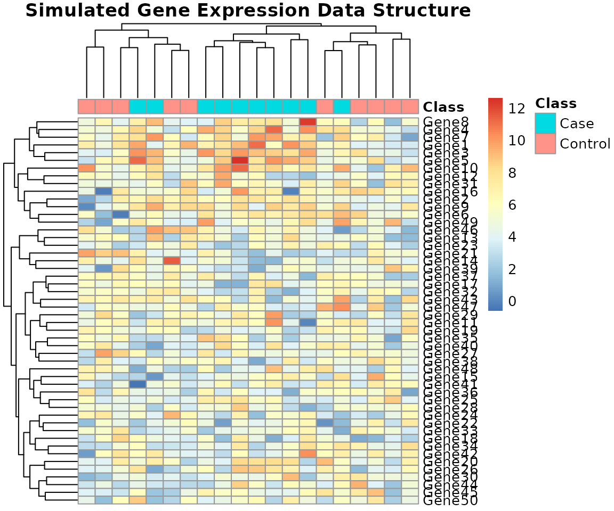
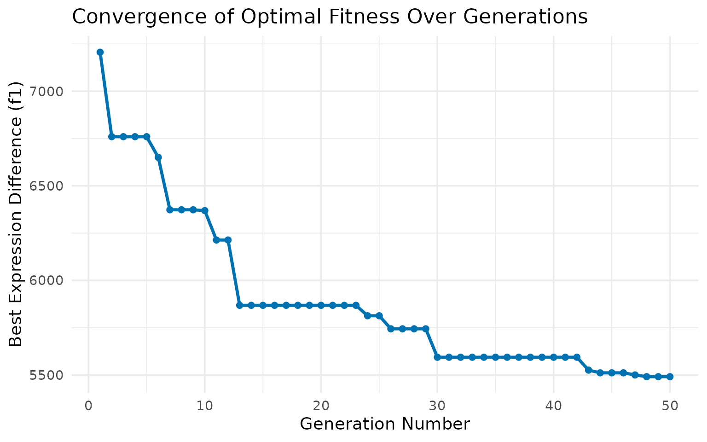
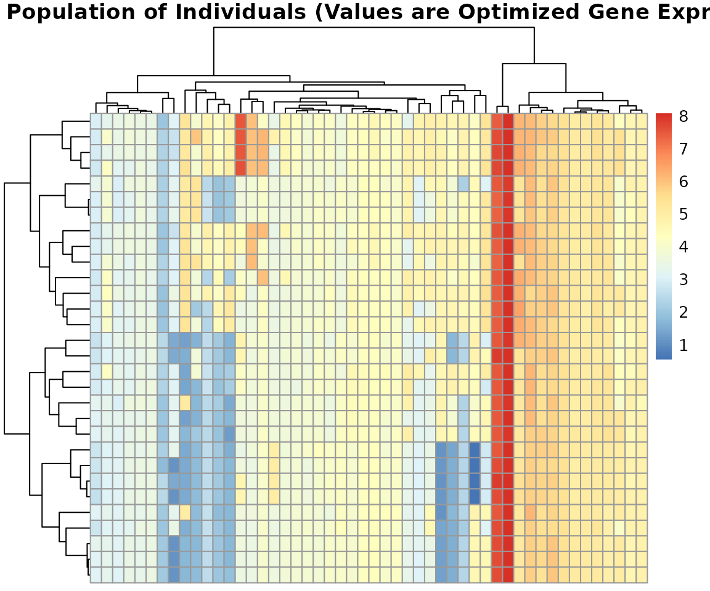
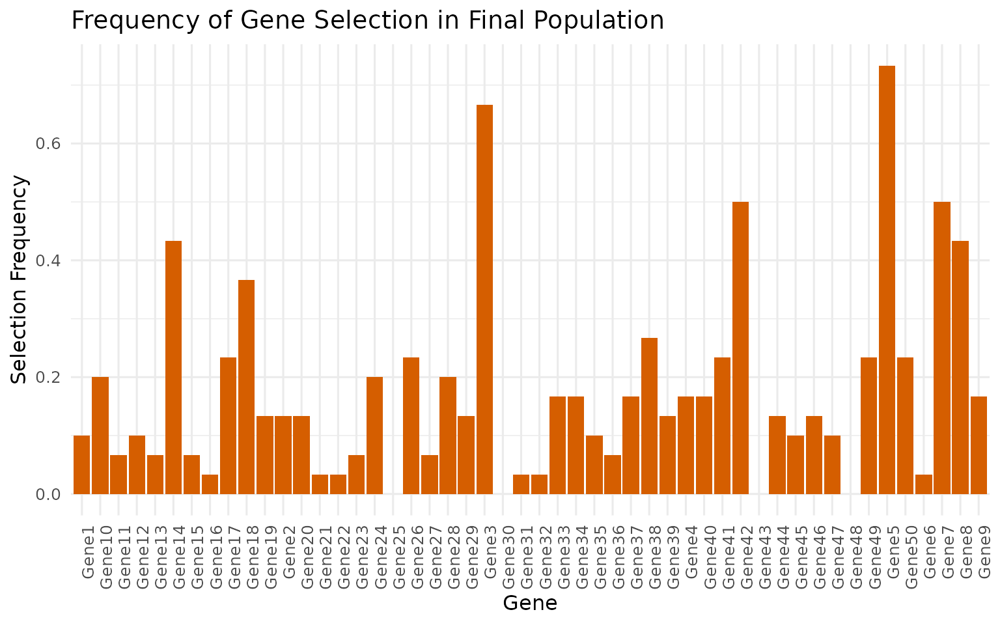

# Usage Demonstration of BioGA

## Introduction to BioGA

`BioGA` is a powerful R package designed to execute a multi-objective
Genetic Algorithm (GA) tailored for the optimization of high-dimensional
genomic data. This approach is highly effective in scenarios where
multiple, often conflicting, biological and statistical objectives must
be satisfied simultaneously.

This vignette provides a hands-on guide, walking through the essential
steps of preparing data, running the GA, and interpreting the critical
results, including convergence, diversity, and gene selection frequency.

## 1. Prepare Simulated Genomic Data

We begin by simulating a typical gene expression matrix, mimicking data
from a microarray or RNA-sequencing experiment. The data will feature
two classes (Control and Case) and will include a subset of
differentially expressed genes to provide a clear optimization target.

``` r

set.seed(123)
n_genes <- 50
n_samples <- 20

# Simulate base expression data (50 genes x 20 samples)
genomic_data <- matrix(rnorm(n_genes * n_samples, mean = 5, sd = 2),
    nrow = n_genes, ncol = n_samples)

# Define class labels and introduce differential expression for the first 10 genes
class_labels <- rep(c("Control", "Case"), each = 10)
DE_genes_indices <- 1:10
genomic_data[DE_genes_indices, class_labels == "Case"] <-
    genomic_data[DE_genes_indices, class_labels == "Case"] + 3

rownames(genomic_data) <- paste0("Gene", 1:n_genes)
colnames(genomic_data) <- paste0("Sample", 1:n_samples)

# Create annotation bar for visualization
col_annotation <- data.frame(Class = factor(class_labels))
rownames(col_annotation) <- colnames(genomic_data)
```

### Data Visualization (Heatmap)

A heatmap visually confirms the structure of the simulated data,
allowing us to see the clusters formed by the differentially expressed
genes and the samples.

``` r

pheatmap(genomic_data,
    cluster_rows = TRUE, cluster_cols = TRUE,
    annotation_col = col_annotation,
    main = "Simulated Gene Expression Data Structure",
    show_colnames = FALSE)
```



## 2. Run the Genetic Algorithm

The core of the analysis involves running the multi-objective GA using
the `bioga_main_cpp` function. We specify key parameters defining the
evolutionary process and the objectives.

### GA Parameters

The GA is configured using standard parameters common to evolutionary
computation:

| Parameter | Value | Description |
|:---|:---|:---|
| `population_size` | 30 | Number of individuals in the population. |
| `num_generations` | 50 | Total number of evolutionary steps. |
| `crossover_rate` | 0.9 | Probability of performing Crossover (SBX). |
| `eta_c` | 20.0 | Distribution index for SBX (controls locality). |
| `mutation_rate` | 0.1 | Base probability of mutation. |
| `weights` | `c(1.0, 0.5)` | Scaling factors applied to ($`f_1`$, $`f_2`$) before storage. Under Pareto (NSGA-II) ranking these do not change which solutions are non-dominated. |

``` r

result <- bioga_main_cpp(
    genomic_data = genomic_data,
    population_size = 30,
    num_generations = 50,
    crossover_rate = 0.9,
    eta_c = 20.0,
    mutation_rate = 0.1,
    num_parents = 20,
    num_offspring = 20,
    num_to_replace = 10,
    weights = c(1.0, 0.5), # w1*f1 + w2*f2
    seed = 42
)
```

## 3. Analyze Fitness Convergence

One of the most important results is demonstrating that the GA
successfully drives the population toward optimal fitness over time. To
track convergence accurately, we manually iterate the GA steps and
record the fitness of the best individual at each generation.

The primary objective tracked here is $`f_1`$ (Expression Difference).

``` r

# Function to manually track the best fitness (f1) over generations
track_fitness <- function(data, pop_size, num_gen, w) {
    # Re-initialize population for the tracker
    pop <- initialize_population_cpp(data, pop_size, seed = 42)
    # Re-use parameters from run_ga
    p_mut <- 0.1
    num_p <- 20
    num_o <- 20
    num_rep <- 10

    best_fit_f1 <- numeric(num_gen)

    for (g in 1:num_gen) {
        fit <- evaluate_fitness_cpp(data, pop, weights = w)
        
        # Track the minimum f1 value (first column)
        best_fit_f1[g] <- min(fit[, 1]) 
        
        # Evolutionary Cycle
        parents <- selection_cpp(pop, fit, num_p)
        offspring <- crossover_cpp(parents, num_o)
        mutated <- mutation_cpp(offspring, p_mut, g, num_gen)
        fit_off <- evaluate_fitness_cpp(data, mutated, w)
        pop <- replacement_cpp(pop, mutated, fit, fit_off, num_rep)
    }
    
    data.frame(Generation = 1:num_gen, Best_F1 = best_fit_f1)
}

fitness_trace_df <- track_fitness(genomic_data, 30, 50, w = c(1.0, 0.5))

# Plotting the convergence
ggplot(fitness_trace_df, aes(x = Generation, y = Best_F1)) +
    geom_line(color = "#0072B2", size = 1.2) +
    geom_point(color = "#0072B2") +
    labs(x = "Generation Number", 
         y = "Best Expression Difference (f1)",
         title = "Convergence of Optimal Fitness Over Generations") +
    theme_minimal(base_size = 14) 
```

 The
plot demonstrates the characteristic convergence curve of a GA, where
the initial rapid improvement is followed by slower refinement as the
population approaches the Pareto front.

## 4. Analysis of Final Population

The `result$population` matrix contains the 30 individuals (rows)
evolved after 50 generations. Because the second objective penalises
large gene values (the mean absolute value, $`f_2`$), we expect the
individuals to have shrunk many expression values toward zero relative
to the raw data.

### 4.1 Population Diversity Heatmap

Visualizing the final population reveals the genetic diversity and the
consensus gene set found by the algorithm.

``` r

pheatmap(result$population,
    main = "Final Population of Individuals (Values are Optimized Gene Expression)",
    cluster_rows = TRUE, cluster_cols = TRUE,
    show_rownames = FALSE, show_colnames = FALSE,
    fontsize_row = 8)
```



### 4.2 Gene Selection Frequency

A key application is gene signature selection. The real representation
applies an $`L_1`$ magnitude penalty (a soft, continuous effect), so it
does not give a clean selected/not-selected answer. To obtain a strict
signature we use the **binary representation**, where each gene is
either selected or not and the class `labels` guide the objective. We
run the GA again in binary mode and measure how often each gene is
selected across the final population.

``` r

result_binary <- bioga_main_cpp(
    genomic_data = genomic_data,
    population_size = 30,
    num_generations = 50,
    crossover_rate = 0.9,
    eta_c = 20.0,
    mutation_rate = 0.1,
    num_parents = 20,
    num_offspring = 20,
    num_to_replace = 10,
    weights = c(1.0, 1.0),
    seed = 42,
    labels = class_labels,
    representation = "binary"
)

# Each gene is selected when its indicator exceeds 0.5
gene_selection_freq <- colMeans(result_binary$population > 0.5)
gene_selection_df <- data.frame(
    Gene = rownames(genomic_data),
    Frequency = gene_selection_freq
)

ggplot(gene_selection_df, aes(x = Gene, y = Frequency)) +
    geom_bar(stat = "identity", fill = "#D55E00") +
    labs(x = "Gene", y = "Selection Frequency",
         title = "Frequency of Gene Selection in Final Population") +
    theme_minimal(base_size = 12) +
    theme(axis.text.x = element_text(angle = 90, hjust = 1)) 
```


Genes with high selection frequency are those the algorithm most
consistently kept in the selected set, and form the candidate gene
“signature”. The differentially expressed genes (the first ten) tend to
be selected more often than the remaining genes.

## 5. Advanced Feature: Network Constraint

The `BioGA`’s mutation operator can be constrained by a gene-gene
interaction network ($`N`$). This allows the search to prioritize
biologically plausible changes, reducing the mutation magnitude for
genes that are highly connected. We demonstrate how the `mutation_cpp`
function handles external network information.

``` r

# 1. Create a dummy network matrix (e.g., co-expression or regulatory links)
network_mat <- matrix(runif(n_genes^2, 0, 0.5), nrow = n_genes)
diag(network_mat) <- 0 # No self-loops

# Use the final population as a starting point for mutation
pop_to_mutate <- result$population 

mutated_with_net <- mutation_cpp(
    offspring = pop_to_mutate,
    mutation_rate = 0.1,
    iteration = 10,
    max_iterations = 50,
    network = network_mat # Injecting the network constraint
)

pheatmap(mutated_with_net,
    main = "Population After Mutation with Network Constraint",
    show_rownames = FALSE, show_colnames = FALSE)
```

When a network is provided, the mutation magnitude of gene $`j`$ is
damped by its relative connectivity, $`\Delta_j(1 - d_j/d_{\max})`$, so
that changes to highly connected hub genes are reduced.

## Summary

The practical application:

1.  Simulated and visualized a two-class genomic dataset.
2.  Executed the two-objective GA, tracking data fidelity and parsimony.
3.  Provided a robust method for tracking and visualizing fitness
    convergence.
4.  Analyzed the final population for diversity and, using the binary
    representation, identified candidate gene-signature members.

### Further Customization

To apply `BioGA` to your research:

- **Real Data:** Replace `genomic_data` with your own RNA-seq,
  microarrays, or proteomics data matrix.
- **Custom Objectives:** `BioGA` optimises two fixed objectives per
  representation (see
  [`?bioga_fitness`](https://danymukesha.github.io/BioGA/reference/bioga_fitness.md)).
  Domain knowledge cannot yet be injected as an arbitrary user-supplied
  fitness function in this release.
- **Network Integration:** Define a meaningful adjacency matrix for
  `network` based on databases like STRING or pre-computed co-expression
  to damp mutation of highly connected genes.

### Performance Tip

For extremely large datasets (high $`n`$ or high $`p`$):

> Use `RcppParallel::setThreadOptions(numThreads = N)` before running
> `bioga_main_cpp` to explicitly control CPU thread usage and maximize
> parallel processing performance.

**Session Info**

``` r

sessioninfo::session_info()
#> ─ Session info ───────────────────────────────────────────────────────────────
#>  setting  value
#>  version  R version 4.6.1 (2026-06-24)
#>  os       Ubuntu 24.04.5 LTS
#>  system   x86_64, linux-gnu
#>  ui       X11
#>  language en
#>  collate  C.UTF-8
#>  ctype    C.UTF-8
#>  tz       UTC
#>  date     2026-10-17
#>  pandoc   3.8.3 @ /opt/hostedtoolcache/pandoc/3.8.3/x64/ (via rmarkdown)
#>  quarto   NA
#> 
#> ─ Packages ───────────────────────────────────────────────────────────────────
#>  package              * version date (UTC) lib source
#>  abind                  1.4-8   2024-09-12 [1] RSPM
#>  Biobase                2.72.0  2026-04-28 [1] Bioconduc~
#>  BiocGenerics           0.58.1  2026-05-14 [1] Bioconduc~
#>  BioGA                * 0.99.18 2026-10-17 [1] local
#>  bookdown               0.48    2026-08-28 [1] RSPM
#>  bslib                  0.12.0  2026-08-04 [1] RSPM
#>  cachem                 1.1.0   2024-05-16 [1] RSPM
#>  cli                    3.6.6   2026-04-09 [1] RSPM
#>  DelayedArray           0.38.2  2026-05-26 [1] Bioconduc~
#>  desc                   1.4.3   2023-12-10 [1] RSPM
#>  digest                 0.6.39  2025-11-19 [1] RSPM
#>  dplyr                * 1.2.1   2026-04-03 [1] RSPM
#>  evaluate               1.0.5   2025-08-27 [1] RSPM
#>  farver                 2.1.2   2024-05-13 [1] RSPM
#>  fastmap                1.2.0   2024-05-15 [1] RSPM
#>  fs                     2.1.0   2026-04-18 [1] RSPM
#>  generics               0.1.4   2025-05-09 [1] RSPM
#>  GenomicRanges          1.64.0  2026-04-28 [1] Bioconduc~
#>  ggplot2              * 4.0.3   2026-04-22 [1] RSPM
#>  glue                   1.8.1   2026-04-17 [1] RSPM
#>  gtable                 0.3.6   2024-10-25 [1] RSPM
#>  htmltools              0.5.9   2025-12-04 [1] RSPM
#>  htmlwidgets            1.6.4   2023-12-06 [1] RSPM
#>  IRanges                2.46.0  2026-04-28 [1] Bioconduc~
#>  jquerylib              0.1.4   2021-04-26 [1] RSPM
#>  jsonlite               2.0.0   2025-03-27 [1] RSPM
#>  knitr                  1.52    2026-09-06 [1] RSPM
#>  labeling               0.4.3   2023-08-29 [1] RSPM
#>  lattice                0.22-9  2026-02-09 [3] CRAN (R 4.6.1)
#>  lifecycle              1.0.5   2026-01-08 [1] RSPM
#>  magrittr               2.0.5   2026-04-04 [1] RSPM
#>  Matrix                 1.7-5   2026-03-21 [3] CRAN (R 4.6.1)
#>  MatrixGenerics         1.24.0  2026-04-28 [1] Bioconduc~
#>  matrixStats            1.5.0   2025-01-07 [1] RSPM
#>  otel                   0.2.0   2025-08-29 [1] RSPM
#>  pheatmap             * 1.0.13  2025-06-05 [1] RSPM
#>  pillar                 1.11.1  2025-09-17 [1] RSPM
#>  pkgconfig              2.0.3   2019-09-22 [1] RSPM
#>  pkgdown                2.2.1   2026-07-07 [1] RSPM
#>  R6                     2.6.1   2025-02-15 [1] RSPM
#>  ragg                   1.5.2   2026-03-23 [1] RSPM
#>  RColorBrewer           1.1-3   2022-04-03 [1] RSPM
#>  Rcpp                   1.1.2   2026-07-05 [1] RSPM
#>  RcppParallel           6.2.1   2026-08-27 [1] RSPM
#>  rlang                  1.3.0   2026-07-05 [1] RSPM
#>  rmarkdown              2.32    2026-09-01 [1] RSPM
#>  S4Arrays               1.12.1  2026-09-22 [1] Bioconduc~
#>  S4Vectors              0.50.3  2026-09-16 [1] Bioconduc~
#>  S7                     0.2.2   2026-04-22 [1] RSPM
#>  sass                   0.4.10  2025-04-11 [1] RSPM
#>  scales                 1.4.0   2025-04-24 [1] RSPM
#>  Seqinfo                1.2.0   2026-04-28 [1] Bioconduc~
#>  sessioninfo          * 1.2.4   2026-06-04 [1] RSPM
#>  SparseArray            1.12.3  2026-09-22 [1] Bioconduc~
#>  SummarizedExperiment   1.42.0  2026-04-28 [1] Bioconduc~
#>  systemfonts            1.3.2   2026-03-05 [1] RSPM
#>  textshaping            1.0.5   2026-03-06 [1] RSPM
#>  tibble                 3.3.1   2026-01-11 [1] RSPM
#>  tidyselect             1.2.1   2024-03-11 [1] RSPM
#>  vctrs                  0.7.3   2026-04-11 [1] RSPM
#>  withr                  3.0.3   2026-06-19 [1] RSPM
#>  xfun                   0.62    2026-10-16 [1] RSPM
#>  XVector                0.52.0  2026-04-28 [1] Bioconduc~
#>  yaml                   2.3.12  2025-12-10 [1] RSPM
#> 
#>  [1] /home/runner/work/_temp/Library
#>  [2] /opt/R/4.6.1/lib/R/site-library
#>  [3] /opt/R/4.6.1/lib/R/library
#>  * ── Packages attached to the search path.
#> 
#> ──────────────────────────────────────────────────────────────────────────────
```

\`\`\`
